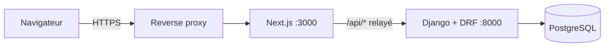

# Architecture : v0.1 (tableau de bord)

## Décisions

| # | Décision | Raison | Alternative écartée |
|---|---|---|---|
| A1 | Interface **Next.js 16 + React 19 + TypeScript + Tailwind 4** | Technologies modernes demandées ; composants réutilisables pour la suite | Django seul avec HTMX : plus rapide au départ, interface moins interactive |
| A2 | Serveur **Django 5.2 LTS + DRF** | Authentification, rôles, migrations et administration fournis ; adapté à une échéance courte | FastAPI : bien pour une API pure, mais il faudrait écrire administration et gestion des comptes |
| A3 | **PostgreSQL 16** | Base libre, contraintes d'intégrité (dates, clés), auto-hébergeable | SQLite : utilisée seulement en développement |
| A4 | Authentification par **session + cookie HttpOnly**, API relayée par Next (même origine) | Pas de jeton lisible par le navigateur ; protection CSRF native | JWT stocké côté client : surface d'attaque plus large |
| A5 | **Calculs du tableau de bord côté serveur** (`apps/dashboard/services.py`) | Une seule source de vérité, testable, droits appliqués au même endroit | Calcul dans le navigateur |
| A6 | Déploiement **Docker Compose** sur VPS | Exigence d'hébergement sur serveur de l'entreprise | PaaS |

## Vue d'ensemble

## Modèle de données

`Country` · `User` (rôle : admin / responsable / membre) · `Presence` (disponibilité, raison, lieu) · `Project` (pays, responsable, dates, statut) → `ProjectActivity` → `Task` (statut : en attente, en cours, fait, en revue, approuvé) · `Milestone` (échéance, date d'atteinte) · `CalendarEvent` · `ActivityLog`.

Contraintes : `début < fin` sur projets et activités (base de données) ; une tâche ne peut viser qu'une activité de son projet (API).

## Règles métier (à valider avec le Baromètre)

- Tâche « avancée » : fait, en revue ou approuvée.
- Projet **en retard** : un jalon dépassé non atteint, ou au moins 2 tâches en retard. **À surveiller** : 1 tâche en retard, ou avancement inférieur de plus de 15 points au temps écoulé. Un projet sans tâche n'est pas pénalisé.
- **Performance** = avancement réel ÷ avancement attendu à ce jour (masquée au tout début du projet et sans tâche).
- Droits : l'administrateur voit et fait tout ; le responsable gère ses projets (création de tâches, approbation, relance) ; le membre ne modifie que ses propres tâches et ne peut pas les approuver.

## API v1

| Méthode | Chemin | Rôle |
|---|---|---|
| GET | `/auth/csrf/` | pose le cookie CSRF |
| POST | `/auth/login/`, `/auth/logout/` | connexion, déconnexion |
| GET | `/auth/me/` | utilisateur courant |
| GET | `/dashboard/?country=&period=&week=&trend_project=` | toutes les données du tableau de bord |
| GET | `/countries/` | pays |
| GET, POST | `/tasks/` | liste, création (administrateur, responsable du projet) |
| POST | `/tasks/{id}/status/` | changement de statut |
| POST | `/tasks/{id}/remind/` | relance (journalisée) |

Schéma OpenAPI : `/api/schema/`, interface : `/api/docs/`.

## Tests

31 tests Django : règles de calcul de l'état d'un projet, périmètre par rôle, droits de création, de modification et d'approbation, validations, connexion, et concordance des chiffres de démonstration avec la maquette.

## Reste à concevoir

Assistant IA conversationnel (appel à un modèle de langage, exécution d'actions avec confirmation et droits de l'utilisateur), import de Gantt (formats à confirmer), notifications, écrans suivants, sauvegardes et supervision.
